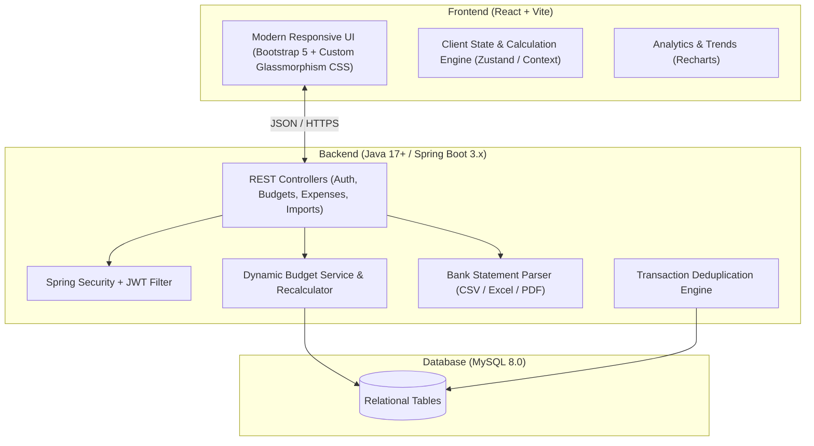
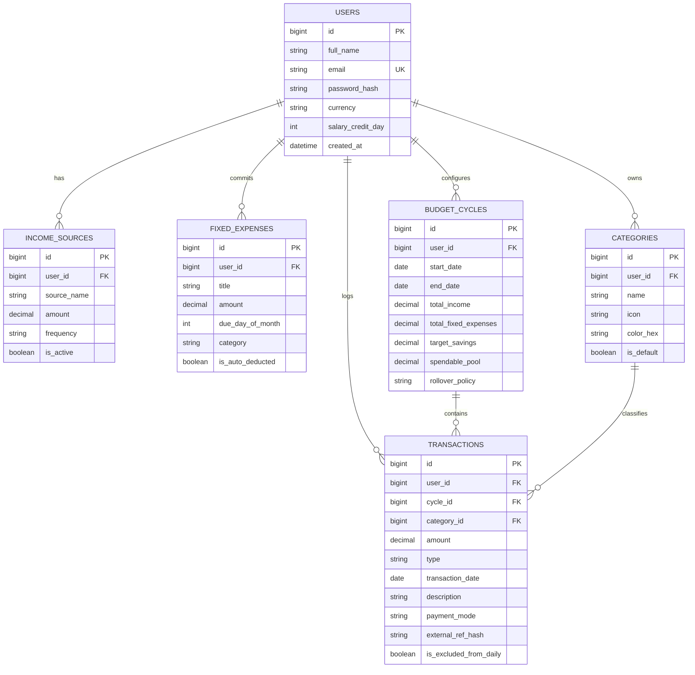

# Hisab — Dynamic Daily Budget & Expense Intelligence

> **Stop tracking what you already spent. Know what you can safely spend today.**

Hisab is an intelligent personal finance platform designed for salaried individuals and household budget planners. Rather than acting as a static record book, Hisab continuously recalculates your **Safe-to-Spend Daily Limit** based on monthly income, committed fixed expenses, actual spending, and remaining calendar days.

---

## 💡 Core Philosophy & Example

If you earn **₹60,000/month** and have:
- **EMI:** -₹10,000
- **Children's Education / Rent:** -₹10,000
- **Committed Total:** ₹20,000

Your **Monthly Spendable Pool** = **₹40,000**.
Over 30 days, your initial daily budget is **₹1,333.33/day**.

If today you spend **₹630** (Groceries ₹250, Petrol ₹200, Food delivery ₹180):
- **Today's Remaining Buffer:** **₹703.33**
- Unspent money automatically cushions future days or gets routed to your savings target!
- If you overspend, future daily limits gently adjust down so your month-end financial peace is preserved.

---

## 🛠️ Architecture & Tech Stack

- **Frontend:** React 18 / 19 + Vite + CSS (Glassmorphism, dark/light theme, micro-animations) + Recharts
- **Backend:** Java 21 + Spring Boot 3 + Spring Security (JWT)
- **Database:** MySQL 8.0 / H2 for development
- **Key Modules:**
  1. User & Authentication Management
  2. Income & Salary Cycle Setup
  3. Committed Fixed Expenses (EMIs, Bills, Subscriptions)
  4. Dynamic Daily Budget Engine (Recalculation, Floating Rollover)
  5. Transaction Logging & Classification
  6. Bank Statement Parser (CSV / Excel import with deduplication)
  7. Smart Visual Analytics & Projections

---

## 📁 Repository Structure

```text
Hisab/
├── frontend/        # React + Vite application
├── backend/         # Spring Boot 3 REST API
└── README.md
```

Detailed design and mathematical model: see [project_blueprint.md](file:///C:/Users/ashwi/.gemini/antigravity-ide/brain/3d1f4079-2b52-4b2d-b87d-c9c1e684871a/project_blueprint.md).
# Project Blueprint: Dynamic Daily Budget & Expense Intelligence (Hisab)

## 1. Executive Summary & Core Philosophy

Traditional expense managers fail because they act as **post-mortem logs** (telling you what you already spent). 
This platform is an **active financial co-pilot** that answers one critical question every morning:
> **"Aaj main guilt-free kitna kharch kar sakta hoon?" (What is my safe-to-spend limit today?)**


---

## 2. Core Calculation Engine (Mathematical Formulas)

### A. Monthly Spendable Pool ($S_{month}$)
$$S_{month} = I_{total} - \sum E_{fixed} - S_{target}$$
Where:
- $I_{total}$: Net monthly income across all verified sources.
- $\sum E_{fixed}$: Sum of committed fixed expenses (EMI, rent, tuition, insurance, utility bills).
- $S_{target}$: Explicit monthly savings or emergency fund reserve (optional).

### B. Dynamic Daily Budget ($B_{daily}(d)$)
On any given day $d$ of a billing cycle of $N$ days (where $d \in [1, N]$):
$$B_{daily}(d) = \frac{S_{month} - \sum_{i=1}^{d-1} X_i}{N - d + 1}$$
Where:
- $\sum_{i=1}^{d-1} X_i$: Cumulative actual spending up to yesterday.
- $N - d + 1$: Number of remaining days in the cycle, including today.

### C. Today's Remaining Spendable ($R_{today}$)
$$R_{today} = B_{daily}(d) - X_{today}$$
- If $R_{today} > 0$: User is within budget. Surplus automatically cushions future days or moves to savings.
- If $R_{today} < 0$: User overspent today. The engine automatically lowers future daily limits to keep month-end savings intact.

### D. Month-End Projected Savings ($P_{savings}$)
$$P_{savings} = S_{month} - \left( \sum_{i=1}^{d} X_i + B_{daily}(d+1) \times (N - d) \right)$$

---

## 3. High-Level System Architecture



---

## 4. Proposed Database Schema (Relational ERD)



---

## 5. Project Folder Structure (Monorepo Layout)

```text
Hisab/
├── frontend/                     # React + Vite application
│   ├── public/                   # Static assets, icons
│   ├── src/
│   │   ├── assets/               # Branding graphics, styling
│   │   ├── components/
│   │   │   ├── common/           # Button, Modal, Card, Input, Badge
│   │   │   ├── dashboard/        # BudgetDial, TodaySpendCard, MonthProjection
│   │   │   ├── transactions/     # TransactionList, AddExpenseModal, FilterBar
│   │   │   ├── setup/            # Salary & Fixed Expense onboarding wizard
│   │   │   └── analytics/        # CategoryPieChart, SpendingVelocityGraph
│   │   ├── context/              # BudgetContext / AuthContext
│   │   ├── hooks/                # useBudgetEngine, useTransactions
│   │   ├── services/             # api.js (Axios client with interceptors)
│   │   ├── styles/               # index.css (tokens, dark/light theme, glassmorphism)
│   │   ├── utils/                # calculations.js, formatters.js, dateUtils.js
│   │   ├── App.jsx
│   │   └── main.jsx
│   ├── package.json
│   └── vite.config.js
│
├── backend/                      # Spring Boot 3 application
│   ├── src/
│   │   ├── main/
│   │   │   ├── java/com/hisab/
│   │   │   │   ├── config/       # SecurityConfig, CorsConfig, SwaggerConfig
│   │   │   │   ├── controller/   # AuthController, BudgetController, TransactionController
│   │   │   │   ├── dto/          # Request & Response DTOs
│   │   │   │   ├── entity/       # JPA Entities (User, Transaction, BudgetCycle, etc.)
│   │   │   │   ├── repository/   # Spring Data JPA Repositories
│   │   │   │   ├── service/      # BudgetCalculationService, StatementParserService
│   │   │   │   └── util/         # HashUtil (deduplication), DateUtils
│   │   │   └── resources/
│   │   │       ├── application.yml
│   │   │       └── db/migration/ # Flyway / Liquibase SQL schemas
│   │   └── test/                 # JUnit 5 & Mockito test suite
│   ├── pom.xml
│   └── mvnw
└── README.md
```

---

## 6. Phased Implementation Roadmap

| Phase | Milestone | Deliverables |
| :--- | :--- | :--- |
| **Phase 1** | **Budget Engine & Interactive Prototype** | React + Vite UI with instant onboarding wizard (Salary + Fixed commitments), Dynamic daily budget calculation, manual expense logging, and responsive dashboard. |
| **Phase 2** | **Full Spring Boot Backend & Persistence** | Spring Boot REST API, MySQL JPA entities, JWT authentication, CRUD operations for transactions, categories, and budget cycles. |
| **Phase 3** | **Analytics & Smart Insights** | Velocity charts, category breakdown, month-end projections, and overspending warning triggers. |
| **Phase 4** | **Bank Statement Import & Deduplication** | CSV/Excel upload with transaction categorization rules and SHA-256 deduplication hash checks. |
| **Phase 5** | **Mobile App & Notification Co-pilot** | React Native build reusing backend REST APIs, daily morning "Today's Limit" notification, and evening check-ins. |
